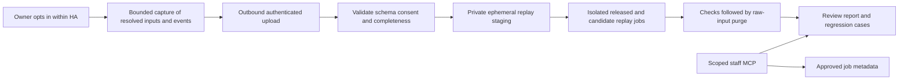

# Optimizer fleet regression plan

Status: implementation started. The local replay milestone is implemented; remote enrolment, the complete HA reader matrix and the private fleet service remain later phases. This plan covers the Home Assistant integration, full HA-wide read-only diagnostics and a separate regression data service. Implementing code does not enrol owners or activate sharing.

## Implemented checkpoint

The HA implementation starts from fetched `origin/main` at
`215b2d4877e62f858fde25d5f7459b71f6b99fe8` (manifest `2.12.1684`).
The separate broker foundation starts from
`3cd8cf7ed4d3205bb4079911197fbadcdd88bc55` in the Cloud repository.

- [Local optimizer replay](optimizer-replay.md): closed effective-state/input
  capture at every solver attempt, explicit local export, fresh-process A/A and
  candidate replay, trusted scoring and explicit unsupported/source-coverage gaps.
- [HA read backend](ha-read-backend.md): all-domain cached entity discovery/read,
  bounded pagination, pre/post authorization checks and a read-only MCP dispatcher.
  The capability manifest reports the remaining adapters as unavailable; this is
  not yet complete full HA access.
- The Cloud `ha-diagnostics` library contains independent grant namespaces,
  continuity/revocation/refresh/page-release state machines, transactional storage
  and signed-metadata helpers. It has no route, OAuth issuer or deployed binding.

The existing ticket service is unchanged. No live installation, customer grant,
raw corpus, remote capture or mandatory fleet gate is enabled. Complete the
remaining Phase 2 service/readers before proposing a customer pilot. Broader
scoring, temporal replay, physical simulation and measured pilot budgets remain
explicit work rather than implied coverage of the first solver replay layer.

## Owner-selected pilot policy

The first pilot permits **Codex and Claude**, using separately registered client
identities and disclosed processor policies. Exact client IDs and callbacks must
be configured and shown during approval; product names alone are not credentials.

Optimizer captures use **replay, then delete**. Keep inputs only for the approved
paired replay job, purge them after completion/cancellation/expiry and retain
bounded summary results. Do not archive raw captures, normalized/effective-state
copies or reconstruction-capable case artifacts. Do not collect an unattended
raw backlog. Later comparisons obtain fresh captures. Historical summaries are
receipts of completed runs rather than replayable historical datasets.

## Goal and recommendation

Let consenting owners contribute optimizer observations so a proposed PowerSync update can be tested against many real system configurations before release. Test the released and candidate revisions against the same transient inputs, identify changes, purge those inputs after replay, and turn confirmed defects into independently authored synthetic regression tests.

Build an opt-in regression programme with ongoing enrolment, transient raw processing, bounded summary retention and revocable access. Use MCP to discover cases and inspect results. Use ordinary software jobs to capture data and execute comparisons; an AI conversation should not be required for collection or every test run.

The access scope includes full HA-wide diagnostic reads, beyond PowerSync entities or the existing small semantic-field allowlist. An approved investigator can discover and inspect other integrations, automations and configuration that influence the energy system. Preserve the original read-only requirement: this scope covers observation and configuration inspection, while mutation/device commands require a distinct future permission. Whole-HA access and ongoing regression contribution have independent grants and data-retention choices.

The useful deliverable is a reproducible paired replay runner, diverse fresh observations and a durable independent synthetic regression suite. Longer access is one part of that system. Start by proving that captured inputs can reproduce an optimizer run before expanding remote access.

## Original design baseline

The original design reviewed fetched HA `origin/main` at `5ebf8a17dfa00cf4f90a28cbe41aa7491d0e5224`, manifest `2.12.1674`, and broker `origin/main` at `55f08aea92ef1f532dce735867efbdb83a392596`.

| Existing component | Reuse | Gap to close |
| --- | --- | --- |
| HA `support/ha.py`, `collector.py`, `history.py`, `contract.json` | Reviewed data projection, local bounded recording and access receipts | Current optimizer observations explicitly set `input_bundle_complete=false`. |
| Coordinator `_run_optimizer_once` | Concrete boundary where resolved solver arguments are available | Constructor parameters, mutable optimizer attributes and retry-specific state also affect a solve. |
| Coordinator `_support_plan_observer` | Captures a committed schedule after solving and overlays | A final result is insufficient to reconstruct preprocessing, intermediate attempts or exceptions. |
| `scripts/benchmark_lp_optimizer.py` | Offline loading, fixed time, synthetic scenarios, alternate component root and solver measurements | Extend through a shared replay adapter rather than maintaining a second optimizer implementation. |
| Broker `worker/src/support/` | Closed schemas, scoped authorization, revocation and audit patterns | Current support authority is ticket-bound, boot-bound and short-lived; it is not a fleet enrolment service. |
| Full-suite regression and release gate | Existing required publication evidence | Fleet replay adds coverage; it cannot replace trusted matching full-suite success. |

The original broker design baseline describes a single pilot Durable Object and limits including eight live/pending sessions, four pending jobs per session and 12 requests per minute per session. Fleet collection needs separate capacity design rather than larger constants in the ticket service. Revalidate these capacity limits before service implementation or activation; they are not a live service health assessment.

## Architecture

Keep the regression service separate from ticket sessions and their tokens. Shared low-level schema and cryptographic helpers are reasonable; extending a support grant into continuing fleet access is not. The HA integration initiates uploads. There is no inbound HA port, provider login, remote code download or control channel.

Candidate code runs in the test environment. Participating homes continue running their installed integration normally. Add local candidate shadow execution only as a later, separately designed feature if there is a demonstrated need and an HA resource budget.

## Owner enrolment and data lifecycle

Use a separate HA administrator control for contributing optimizer regression data. Proposed wording: **Help test PowerSync updates**. Describe it as ongoing, read-only sharing until stopped, with visible replay-then-delete handling and a separate summary retention period; avoid describing credentials or stored data as permanent.

The owner can inspect what is shared, download a representative bundle, see the last successful upload and data volume, pause uploads, leave the programme, and request deletion. Support access, local recording and regression enrolment have independent controls. Existing support consent never enrols anyone automatically.

Enrolment is bound to the installation, config entry, reviewed data scope and policy version. Routine HA restarts may resume an explicitly approved regression enrolment, using a dedicated persisted installation credential. This differs deliberately from support sessions, whose boot-bound semantics remain unchanged. Rotate keys and exchange installation proof for short-lived upload credentials. Define backup-restore and cloned-installation handling before launch so a restored backup cannot silently create two active contributors.

Distinguish installation lineage, active incarnation, centrally enforced enrolment epoch and upload sequence. Conflicting incarnations are quarantined pending explicit administrator takeover; a takeover revokes the prior incarnation. Test restoring an old backup after rotation or revocation, concurrent originals/clones and sequence replay. Do not claim hardware fingerprints prove installation identity.

Changes to the shared categories, processors or purpose require renewed approval. Entity mapping changes invalidate pending bundles and suspend sharing until the new mapping is reviewed. Credential revocation must remain effective across a restart or restore; enforce an installation generation/epoch centrally.

Pilot data handling:

- Capture only when a reviewed replay job and private worker are ready. Bound
  in-memory local buffering and transient processing by bytes and time; exhaustion
  or expiry drops the complete attempt/cycle without delaying control work.
- Delete raw and reconstructable normalized/effective-state inputs from staging
  and worker scratch after replay, cancellation, rejection or expiry. Exclude them
  from backups, archives, public CI artifacts and raw MCP responses.
- A summary cannot contain full schedules, forecasts, inputs or configuration that
  reconstruct the deleted bundle. Retain only the declared bounded result schema.
- Keep metadata-only audit and summary lifetimes separate and explicit. Their
  deletion policy must not create an accidental payload archive.
- Independently authored synthetic regressions may be retained. A redacted or
  date-shifted household trace is still customer data and is not such a fixture.

Pausing stops new capture and upload. Leaving invalidates credentials, removes pending local uploads and blocks further service access. Deletion covers raw bundles, derived private cases, reports and indexes under an explicit deletion SLA, with backup expiry described honestly. Reads and upload finalization recheck active enrolment so delayed work cannot resurrect deleted data. Previously disclosed transcripts cannot be retracted; minimise their contents.

Treat each transient input as immutable for its paired replay, then delete it. A historical summary is not permission to retain or recreate its raw case. Check the enrolment epoch at upload finalization, queue admission, staging, run start, result finalization and every service read. Revocation cancels queued jobs and cancels or quarantines running jobs, blocks their result publication and triggers scratch-data cleanup. Affected required runs become incomplete. Summary receipts may describe a completed replay after raw deletion, but must disclose that its original input is no longer available for rerun. Revoking summary access and deleting installation-linked summaries remain separate operations; no receipt exception permits retaining raw case content.

For transient uploaded regression inputs, use random participant IDs and allowlisted fields. Omit credentials, addresses, coordinates, serials, VINs, raw entity IDs, free text and arbitrary provider payloads. Energy patterns and timestamps can still identify a household: treat the resulting corpus as private, pseudonymous data. HA-wide interactive diagnostics has the separate, broader content contract below; its entity identities and configuration text are not automatically included in regression bundles or retained summaries.

## Full Home Assistant read access

### Access goal and owner experience

An HA administrator can approve **Full Home Assistant read access** for an assigned investigator or approved diagnostic client. The grant may remain enrolled until revoked, as originally requested for ongoing access, while transport credentials and individual read capabilities remain short-lived. Show who can read, the processing/model recipients, active scope, last reads and how to stop access. Support the existing short ticket session and a separately approved ongoing diagnostic grant; do not convert existing ticket consent automatically.

This profile addresses the limitation that the present MCP exposes selected PowerSync fields. It must not filter discovery to `sensor.power_sync_*`, energy entities, seven Recorder entities or a fixed one-hour history window. Owners can choose narrower profiles, but the full profile exposes all supported HA domains and diagnostic categories. Capability gaps must be visible rather than silently returning only the old subset.

### Functional scope

| Category | Full-profile capability |
| --- | --- |
| States and attributes | Discover every HA entity/domain; read current state, supported attributes, units, availability, timestamps and context. Include entities from unrelated integrations when investigating interactions. |
| Registries and relationships | Read entity/device/area/floor/label registries, integration/config-entry associations, disabled/hidden metadata and dependency links where HA exposes them. |
| History and statistics | Query Recorder history, short/long-term statistics and logbook for owner-approved retained periods, with entity selection, pagination, time-zone information, initial-state semantics and retention/coverage gaps. No fixed energy-entity subset. |
| Automation and script behavior | Inspect enabled state, definitions, triggers, conditions, actions, blueprints, referenced entities and retained traces. Include helpers, schedules and scenes relevant to interactions, without executing them. |
| Integration configuration | Read installed integrations, versions, loaded/failed entries, configuration/options, cached diagnostics and custom-component metadata, with credentials removed before disclosure. |
| Dashboard and configuration | Inspect Lovelace/dashboard configuration and HA-managed YAML/configuration content through dedicated read adapters, including referenced files when available. |
| Events and errors | Read redacted HA log/error content, retained automation traces and relevant event records; optionally follow state/event observations through an explicitly bounded subscription. Distinguish raw HA logs from PowerSync's existing structured-only log category. |
| Core and installation health | Read HA version, installation type, loaded components, units, timezone, cached health/Recorder/resource information and available integrations' diagnostic capabilities. |
| Supervisor/host metadata | Where installed and separately exposed, read versions, add-on status, resource data and backup metadata through audited read adapters. Report unsupported on Core/Container or missing host capabilities; do not substitute shell access. |

Entity-state and diagnostic metadata cover all domains. Camera images/streams, recordings and backup contents are separate media/backup payload classes, not implicit side effects of entity discovery. Their availability and scope must be explicit; do not fetch media or initiate a device refresh while reading entity state. Credentials, authentication stores, private keys and secret values remain excluded from diagnostic disclosure.

Home Assistant documents `get_states`, `get_config`, `get_services` and `get_panels` separately from `call_service` and `fire_event` in its [WebSocket API](https://contributors.home-assistant.io/core/internals/websocket-api/). Its [REST API](https://contributors.home-assistant.io/core/internals/rest-api/) also exposes states, history/logbook and an administrator-only error log. Registry, trace, dashboard, configuration-file and Supervisor adapters need their own source/version checks; the API examples do not establish that every installation supports those categories.

### Tools and implementation boundary

Proposed tools are `ha_get_capabilities`, `ha_search_entities`, `ha_get_states`, `ha_get_registry`, `ha_get_history`, `ha_get_statistics`, `ha_get_logbook`, `ha_get_automations`, `ha_get_scripts`, `ha_get_trace`, `ha_get_integration_config`, `ha_get_dashboard`, `ha_read_configuration`, `ha_get_logs`, `ha_get_system` and bounded `ha_observe_events`. These are new proposed tools, not capabilities of the currently deployed MCP.

`ha_get_capabilities` returns the HA/API version, installed readers, permission profile, supported filters, paging limits, retained history bounds and explicit unavailable categories. Entity searches accept every HA domain under the full profile; request budgets control result size through paging, not by excluding unrelated domains. Return schema version, original timestamps, source, redaction/truncation flags and continuation cursor on each result.

Implement a dedicated HA-wide reader layer and a separate broker grant namespace. Reuse transport/revocation/audit primitives where they fit, while preserving the existing ticket protocol and narrower profiles. Use HA-supported APIs or audited in-process readers for each operation. An upstream HA credential, when required by an adapter, remains local; the remote MCP receives only operation-scoped read authority. Do not expose a general REST/WebSocket proxy, arbitrary URL fetcher or a remotely usable administrator token.

Allow arbitrary entity selection under the approved full profile; allow only reviewed read operations. Service invocation, state writes, event firing, automation/script execution, reload/restart, integration changes, configuration/file writes, arbitrary template execution and device refresh are outside this read profile. Audit the operation's actual effects rather than treating its name or HTTP method as proof of read-only behavior. Cached state access must not wake a car, poll an inverter or cause a camera capture.

Configuration readers resolve HA-managed paths under approved configuration roots and prevent traversal, symlink escape and access to authentication/secret stores. Preserve useful configuration structure and identify redacted fields. Inspect cached values and definitions of template entities; avoid arbitrary remote expression execution. Integrations' generic diagnostics callbacks require audit before use because a callback may perform more than a cached read.

### Broader data contract and grant lifecycle

Interactive full-HA diagnostics needs entity IDs, labels, structured attributes, configuration text and error messages. The existing numeric/enum-only support schema cannot represent it and must not be reused with a misleading full-access label. Define a separate versioned schema with typed metadata plus bounded JSON/text payloads, secret redaction and explicit missing/redacted markers. Treat every returned string, trace, YAML comment and log line as untrusted data, never as agent instructions.

Keep HA-wide reads distinct from regression upload. A diagnostics grant does not enrol the installation in the fleet corpus; regression enrolment does not automatically disclose unrelated HA data. Promoting a selected diagnostic artifact into a replay case requires the regression purpose/scope to cover it and a reviewed typed projection. Preserve a private mapping between local entity identities and replay pseudonyms where needed.

Broad reads disclose more than energy telemetry. The owner sees the actual categories and approved recipients/processors before the grant is issued. Check installation, actor/client, grant scope, consent epoch and expiry at every read/page/event batch. A new arbitrary domain is already covered by the full profile; adding a new operation or payload/processor class needs schema/policy review. Do not require a new owner interaction for each read already authorized by the active grant.

Revocation stops new reads/subscriptions and purges staged diagnostic responses under the defined lifecycle. Offline HA returns offline/stale with the original observation time; retained approved exports are labelled snapshots. Do not make an ongoing grant imply an always-fresh system, or silently reuse a revoked grant after restart/restore. Keep access receipts and bounded request/response retention separate from the regression corpus.

### Full-access acceptance and delivery

- Prove the full profile can enumerate and read thousands of entities across PowerSync and unrelated domains, with usable attributes and reliable pagination. It must not fall back to the seven-role support projection.
- Test histories and statistics beyond one hour across several domains, honouring actual Recorder retention and owner-selected periods. Include disabled/removed entities and unknown historical identity explicitly.
- Test automation definitions/traces, dashboard configuration, redacted integration options and HA errors. Validate capability negotiation for unavailable Supervisor, missing traces, unsupported HA versions and uninstalled readers.
- Plant credential canaries in nested attributes, config and logs; verify redaction before transport. Test untrusted text handling, bounded output, path traversal/symlink escape and cross-installation/cursor reuse.
- Instrument side effects so any state/config write, service/event call, device refresh, restart or filesystem write from a read adapter fails its tests. Exercise revoke during pagination/subscription and interruption/offline/restart handling.
- Deliver the capability manifest and broad core state/registry/history readers with the diagnostic service, then complete configuration/trace/dashboard/log/installation adapters before describing that profile as full HA access. Keep the broader regression pilot gates and exact-version verification intact.

## Capture contract

Define a versioned, serializable input contract and a validator before adding remote transport. Capture a coherent immutable copy at each supported computation boundary. A digest identifies exact content; it is not proof of completeness or authenticity.

Make a cycle contain numbered attempts and named stages. Capture each attempt after its temporary overrides, immediately before invocation, in the same serialized context as the solve. `_run_optimizer_once` restores its temporary reserve in `finally`, before the existing final observer; capturing only at that observer loses the effective attempt state. The coordinator already holds `_optimization_lock` across a cycle. Audit setters and executor interactions to establish whether that lock protects every relevant dependency; add a broader immutable invocation interface only if the smaller boundary cannot ensure coherent capture.

Each bundle contains:

| Area | Required evidence |
| --- | --- |
| Identity and versions | Random case/installation reference, capture sequence, schema version, integration version, known source/build identity, Python and solver versions, solver options and platform. Installed version remains self-reported unless separately attested. |
| Time | Frozen decision time, original observation times, timezone and DST rules, exact slot timestamps/durations, forecast issue times and event ordering. |
| Solver configuration | Resolved constructor/configuration values and every relevant externally assigned optimizer attribute, including hardware capabilities and effective limits. |
| Call arguments | Full import/export prices, solar/load forecasts, current SOC, masks, caps, quotas, bonuses, reserves, Cost Neutral plan, manual control projection, EV plan, validity flags and provenance inputs. Preserve units and missing values. |
| Stateful context | For supported sequence replay: acquisition inventory, reconciliation anchors, day budgets, learned parameters, force ownership/deadlines, prior execution intent and relevant persistence state. Use reviewed typed fields rather than dumping `__dict__`. |
| Stages and results | Attempt IDs and retry overrides; raw solver result/status; schedule after each relevant overlay; final plan; typed exception or fallback classification; execution intent where recorded. |
| Coverage | Supported replay layer, missing fields, truncation/drop counts, freshness, mapping/configuration revision, source coherence and digest. |

`complete` is relative to a named contract and replay layer, such as solver replay v1. It must not imply that provider parsing, coordinator transitions or hardware behavior are covered. A new required dependency invalidates completeness until the capture contract and adapter support it. Add contract-coverage tests so new optimizer arguments and externally set parameters cannot silently default during replay.

Version the capture schema, replay adapter, privacy projection and scorer independently. Define canonical encoding, explicit units/currency scale, finite numeric values and unambiguous timestamps. Preserve the original invocation arguments before optimizer normalization; normalized inputs or model diagnostics are separate derived stages, not replacements. Retain defaults only where the original call actually omitted an optional argument and the matching historical adapter defines its semantics. A required new candidate input that is absent from an older case makes that comparison unsupported.

Use stable pseudonyms within a case or sequence to preserve EV/group relationships. Do not merge multiple vehicles or remove distinctions between missing values, false, zero and empty arrays. Prove privacy projection preserves replay behavior. Keep exact dates/timezones private when needed for tariffs and DST; date shifting requires its own layer-specific equivalence proof. Restrict content deduplication to an installation or deletion namespace. Derived migrations record source and destination digests rather than overwriting retained originals.

Capture inputs before solving, including runs that fail or choose fallback. Link all attempts to the committed plan. Preserve full 24/48-hour arrays and validity masks; do not trim them to the displayed schedule. Importing an existing support capture requires separate active regression consent explicitly covering that artifact and purpose; keep it diagnostic-only and outside gate manifests, never silently upgrade it to a complete replay bundle.

Keep copies bounded and inexpensive. Move projection, compression, hashing, persistence and networking off the control-critical path. Recording errors are expendable and visible through counters. Upload losslessly deduplicated series or deltas only if each case can be independently reconstructed and its digest validated. Record gaps explicitly.

Prefer admission by whole cycle. If a later attempt exhausts the budget, discard or mark the entire cycle incomplete; never retain a selected successful attempt as though it were a full cycle. A memory-first local pilot queue can lose unsent data on restart. Any disk-backed queue comes later with a measured write budget. Measure drain-time event-loop lag and executor contention as well as copy time: moving Python work to a thread does not eliminate GIL or shared-executor costs.

## Three test layers

### 1. Identical-input solver comparison

Reconstruct the optimizer with the captured resolved configuration and invoke its normal implementation. Run the captured version, a selected released baseline and the candidate in isolated processes with pinned dependencies, clock, solver settings and tolerances. Where reproducing an older binary is unsupported, report that limitation explicitly.

First show same-version reproducibility on synthetic cases, then privately captured owner cases. Equivalent optimal schedules can differ because of solver tie-breaking; validate feasibility and objective/energy equivalence within declared tolerances rather than requiring every floating-point value or slot to match exactly.

Distinguish production-fidelity replay, using the revision's dependency/solver options, from controlled diagnostic replay with explicitly fixed seed/thread options. Diagnostic overrides are not production-profile performance evidence. Freeze civil decision time where required; retain real monotonic time for resource limits and measurements. Calibrate tie-heavy cases with repeated same-image runs before selecting tolerances or enabling blocking comparisons.

Compare decisions, import/export energy, SOC trajectory, constraint headroom, projected costs, fallback choice and solve resource use. The baseline is a comparator, not a correctness oracle: a valid fix can change the plan, and both versions can share the same bug.

Each comparison includes a baseline-versus-baseline calibration arm under the declared profile. Material unexplained A/A differences invalidate the comparison until classified. Seed synthetic defects such as a removed reserve constraint, reversed export accounting and an off-by-one slot to demonstrate checker sensitivity. Load the runner, evaluator and thresholds from a separately reviewed pinned revision/image; candidate changes cannot redefine their own checks.

Report changed-source coverage against a reviewed mapping of paths and dependencies to replay layers. A layer-1 pass covers the optimizer on captured resolved inputs, not the candidate coordinator that would generate them. Coordinator preprocessing, retry or overlay changes remain `not-covered` until exercised by the relevant replay adapter. Signature or semantic contract changes without a compatible adapter are `unsupported`; unknown changed paths are never assumed covered.

### 2. Coordinator and execution-intent sequence replay

Replay timestamped observations, configuration changes and lifecycle events through the relevant normal coordinator paths. Include stepped SOC, unavailable/stale readings, price revisions, midnight/DST, restart, force expiry and retries. Capture/reconstruct the reviewed state required by each path.

Use fake HA, provider and controller boundaries. Fail any unexpected outbound operation. Emit planned commands and durations as test artifacts; do not send them. Cover preprocessing, reserves, schedule spreading, provider windows, EV/external-energy overlays and cleanup ownership.

Start with a single-cycle replay through the real coordinator retry/overlay path, then extend to event sequences. If a candidate changes feasibility, it may follow a different retry chain; isolated attempt comparisons cannot claim to predict its final committed plan. Record that path change and require chain replay for the corresponding claim. Audit cancellation while an executor job is still running before claiming coherent attempt completion or restored state.

A one-minute charge symptom could arise after the solver's plan is formed. Preserve slot boundaries, replan timestamps and execution duration calculations so a case can test that distinction. This plan does not establish the cause of the Discord example.

Recorded SOC is valid for comparing the next decision from an observed state. Once candidate actions diverge, later recorded SOC represents the historical system, not the candidate's counterfactual battery. Label this sequence mode as observed-state replay and do not claim it proves the candidate's realised day cost.

Encode the mode in the result contract: `identical_input`, `observed_state_step` or `closed_loop_simulation`. An observed-state result cannot populate cumulative counterfactual savings fields. Test this with a charge-versus-idle divergence followed by a historical SOC inconsistent with one of those actions.

Observed-state sequences explicitly re-anchor all supported state at each decision. A free-running exploratory sequence stops making validated behavioral claims at its first divergence from historical actions; later rows are diagnostic only. Do not carry candidate force/provenance state forward alongside contradictory historical SOC and describe the result as a valid physical sequence.

### 3. Closed-loop simulation

Advance each version's own SOC and bookkeeping through a separately tested battery/site model using exogenous load, solar and tariff data. Include efficiency, power limits, export caps, reserve behavior, curtailment and provider execution semantics as supported by that model.

Use only forecasts available at each historical decision time. Realised future readings can score a plan or drive a documented simulation model; they must not be substituted into its forecast inputs. Identify whether load/solar series are truly exogenous, particularly when EV load or curtailment changes with the candidate policy.

Publish modelling assumptions and error bounds. Simulated savings and fake-controller command intent are not measured physical outcomes. Begin with layers 1 and 2; introduce layer 3 when model validation can support useful comparisons.

## Checks and reports

Apply independent checks to both versions, with documented exceptions for intentional manual/force behavior:

- Energy conservation, finite values, aligned timestamps and valid units.
- Applicable reserve/SOC, battery power and grid limits; no forbidden charging/export or invalid use of unavailable price slots.
- Tariff window/quota correctness, Cost Neutral accounting, manual-control priority and EV deadlines where the case claims support.
- Consistent final overlays, plan-to-command duration and restoration ownership, including short interval and boundary behavior.
- Exceptions, solver infeasibility, fallback rate, solve-time distribution and memory limits.

The report identifies candidate/base commits and dependency images, corpus manifest/digests, schema/adapter versions, coverage gaps, test counts and failed cases. Summarise changes by provider, hardware capabilities, tariff and objective; expose individual worst cases so fleet averages cannot hide regressions. Do not sum overlapping forecast horizons and present that as daily realised savings.

Use an independent, versioned pure schedule evaluator with hand-calculated fixtures. Report tariff cashflows, bonuses/caps, inventory valuation, fixed allowances and objective-specific terms separately. Keep a common economic score distinct from each revision's native optimizer objective, and avoid double-counting stored-energy valuation as a new cash purchase. Cover negative prices, irregular durations, 23/25-hour days, EV loads, invalid slots and quota accounting. This evaluator scores schedules; it does not choose a competing schedule.

Always show terminal SOC/energy delta and use a declared version-independent terminal-value rule when comparing horizon costs. Report first-action duration separately from the hypothetical full horizon. Capture ISO currency and price scale; aggregate cash metrics only within one currency, weighted by participant. Prefer absolute deltas near zero or negative net cost. Depleting terminal inventory alone is not an economic improvement.

Freeze the candidate before capture and bind the transient comparison manifest/result to its exact content, baseline, consent epochs and runner version. Collection needs online consenting participants. Publication can use a completed, still-valid bounded summary receipt without recapturing data at that instant, but cannot rerun deleted raw cases. A new candidate or cohort requires fresh comparison evidence. Missing participants, expiry or revocation must never silently turn an incomplete required run into a pass.

Safety/constraint violations and unexplained exceptions block acceptance. Cost, throughput, plan churn and performance changes use predeclared tolerances and require review when exceeded. Keep thresholds versioned and prohibit silently refreshing expected outputs from the candidate. Record intentional behavior changes and their supporting regression tests.

Keep case outcomes separate from run acceptance. Cases may be exact, equivalent, changed, violation, torn, unsupported or not-covered; only supported exact/equivalent results count as passing correctness evidence. Run status is pass, fail, insufficient or invalid. Missing required cohort coverage is insufficient; failed A/A calibration or an unapproved checker makes the run invalid. A changed result may be an intended fix, but needs an explicit reviewed expectation before acceptance.

## MCP and automation

Proposed read tools: `regression_list_cohorts`, `regression_list_cases`, `regression_get_case_summary`, `regression_get_run`, and `regression_compare_results`. Cases here identify summary receipts, not retained raw bundles. Bind reads to the staff actor, approved programme/cohort and current summary-retention/consent state. Do not implement a raw-bundle retrieval tool under the selected replay-then-delete policy.

Separate discovery, metadata, summaries and reports. Raw contribution bundle disclosure to model clients remains disabled; a summary token cannot retrieve deleted/transient inputs through another tool, error or cursor. Bind cursors to actor, filters and consent epoch. Restrict held-out cohort metadata from tuning/discovery until candidate freeze.

Read-only MCP provides two surfaces: HA-wide live/cached diagnostic reads under the full-HA grant, and regression case/report inspection under the fleet grant. Replay jobs are launched by a trusted local command or CI scheduler against an approved revision; the initial MCP does not execute arbitrary commands, fetch arbitrary Git URLs or change enrolment. An operational job launcher, if later needed, has a separate permission and audit contract.

Use the existing approved OAuth patterns with resource-bound, short-lived access tokens and narrowly scoped authorization. Tool annotations describe behavior; enforce read-only access in server routes, credentials and data interfaces. These choices follow the [MCP authorization specification](https://modelcontextprotocol.io/specification/2025-11-25/basic/authorization) and [tool trust guidance](https://modelcontextprotocol.io/specification/2025-11-25/server/tools).

The first clients are Codex and Claude. Their official documentation describes HTTP MCP OAuth and preconfigured client IDs/callbacks: [OpenAI MCP authentication](https://developers.openai.com/plugins/build/auth), [Codex MCP](https://learn.chatgpt.com/docs/extend/mcp?surface=cli) and [Claude Code MCP](https://code.claude.com/docs/en/mcp). Native per-request proof-of-possession support was not established by those pages. Verify the exact client versions or use a reviewed compatible bridge before enabling a sender-bound authority; do not silently drop a required proof. A client/product label does not cryptographically attest the downstream processor.

Collection and routine comparisons require no model calls. Give an agent compact failing-case summaries only when investigation adds value. Keep this dispatcher separate from the Discord support runner; a healthy collection heartbeat must never trigger an investigation for every solve.

## Cohort selection and private execution

Select a small, diverse initial cohort across battery brands/capabilities,
capacity, tariffs, objectives, climates/timezones and EV configurations. More
homes with the same setup do not replace missing classes. Keep summary coverage
counts and an independently synthetic edge-case matrix for rare conditions.

Assign discovery and held-out installations/windows before collecting inputs.
Freeze the exact reviewed candidate and dependencies before evaluation. A private
job obtains fresh observations and runs released/candidate and A/A arms against
the same immutable transient bundle. Purge that bundle after processing. A failing
holdout can inform a synthetic regression, but its deleted household input cannot
be retained as a convenient discovery case. Keep selection/drop metadata and
report the bias of the participating cohort.

No raw case archive is approved. Use public/synthetic or separately approved
independent fixtures for ordinary PR CI. The private trusted runner stages only
an approved live job's inputs, then executes reviewed code with no network, no
broker/customer credentials, restricted filesystem, bounded CPU/RAM/time and
controlled outputs. Untrusted fork/PR code must never receive customer inputs;
sandboxing does not make that disclosure safe. Raw data must not enter logs,
crash dumps, model transcripts, public artifacts or backups.

Even authenticated captures remain untrusted. Enforce the closed schema,
array/decompression limits, finite values, per-participant quotas and idempotent
ordering before processing. Flag unusual physical inputs without clipping away
the trigger. Reported component hashes identify claimed source versions; they
are not remote attestation.

Use ephemeral workers and read-only input mounts. Bound output and disable core
dumps. Purge scratch on success, rejection, failure, timeout and consent loss.
Require purge confirmation before publishing a completed summary; failed cleanup
leaves the run incomplete and inaccessible. Retain the digest and declared result
metrics rather than reconstruction-capable inputs/schedules. A later revision
requires fresh capture; prior summary receipts cannot recreate deleted inputs.

Exercise DNS/network attempts, credential/environment reads, path/symlink escapes
and raw-input logging with synthetic adversarial tests. Filters cannot prove
malicious code harmless: exact trusted revision promotion remains required.

Confirmed recurring defects should become minimal independently authored
synthetic tests. Preserve the causal temporal pattern and constraints without
publishing household traces after merely deleting names or shifting timestamps.
Similarity checks may detect obvious leakage but cannot prove anonymity.

## Delivery order and acceptance

| Phase | Deliverable | Acceptance before continuing |
| --- | --- | --- |
| 1. Replay contract and local proof | First build the offline synthetic harness/checker with A/A and seeded defects; then add default-off local attempt capture/export | Synthetic and owner-local cases reproduce the captured version; missing fields fail explicitly; source-layer coverage is stated; no outbound/control access; captures do not change solve behavior. |
| 2. Opt-in service and full-HA readers | Separate HA-wide diagnostic and regression enrolment/grants, rotating credentials, capability manifest, broad entity/registry/history readers, bounded transient uploads, summary/audit/purge and regression-summary MCP | Explicit scopes, reboot/restore identity, revoke, expiry and read-only side-effect tests pass. Complete the configuration/trace/dashboard/log/installation reader matrix before exposing the full-HA profile as complete. Existing support protocol remains compatible. Raw regression bundles are not exposed through MCP under the selected replay-then-delete policy. |
| 3. Diverse pilot | Proposed 5–10 consenting installations across available hardware/tariff classes, with independently approved diagnostic and regression scopes | Measure full-HA reader coverage/latency plus capture overhead, queue/storage volume, replayability, coverage and error rates over a proposed seven-day window. Unsupported categories stay visible. Expand only against measured capacity. |
| 4. Stateful replay | Single-cycle retry/overlay replay first, then coordinator/event sequences and fake control boundary | Temporal cases cover provenance steps, midnight/restart, force cleanup, EV/provider overlays and command durations. Unexpected network/control calls fail the run. |
| 5. Pre-release fleet comparison | Frozen candidate, fresh private cohort, released/candidate report, held-out assignments and review rules | Initially advisory while reproducibility is calibrated; then make supported checks required through a reviewed gate change. Missing/expired evidence is never a pass. |
| 6. Validated simulation | Battery/site model and scored counterfactual runs | Model-specific conservation/limit tests and validation against independent observations; forecast and outcome data remain distinct. |

Extend nearest existing tests, then run the required adjacent and full audited checks for each implemented slice. Publishing HA code still requires the tracked release procedure and trusted matching full-suite evidence from protected main. Broker service deployment and HA installation each need their own verified rollout; replay success is not either receipt.

Before the pilot, define any intended layer-2 state category as an exact reviewed schema. Include it in initial consent only if its fields and capture are ready for review; otherwise identify the pilot as layer-1/measurement only and obtain fresh scope approval when layer 2 is added. Do not promise that layer-1 recordings can later be upgraded, or use broad future-purpose wording to authorize unknown data fields.

## Suggested implementation boundaries

- HA capture/schema: new regression modules alongside `support/`, with a small reviewed hook at the resolved solver boundary and explicit stage observation in the coordinator. Keep enrolment/transport logic out of the optimizer.
- HA owner UI: reuse the existing support dashboard's administrator-only placement and rendering conventions, with separate regression actions and state.
- HA-wide access: separate reader adapters, capability manifest and broad JSON/text diagnostic schema; separate live-read grant/storage/retention from the small support projection and the numeric replay contract. Add state/registry/history first and complete the full category matrix before claiming full coverage.
- Replay: shared offline loading/configuration helpers with `scripts/benchmark_lp_optimizer.py`; separate replay contracts/adapters and a command such as `scripts/replay_optimizer.py` (proposed name).
- Service: a separate regression authority/storage module and deployment configuration in `powersync-cc`, reusing reviewed primitives where appropriate. Partition ingestion by installation; avoid one global queue or Durable Object for the fleet. Choose concrete storage/queue bindings after measuring payload and query requirements.
- Tests: schema round-trip/completeness, access/purge/restore, same-version replay, stateful regressions, blocked I/O and resource-budget tests. Put public independent synthetic cases in the existing fixture system; transient private recordings stay outside Git and are purged after processing.

Before selecting pilot budgets, measure bytes per solve, transient peak memory/storage, attempts per approved job, retries and replay CPU. For illustration only, 100 KiB at 288 captures/day is about 28 MiB/site/day of transfer, or 16.5 GiB transferred across 20 sites over 30 days. This is a bandwidth illustration, not permission for 30-day raw storage. Capture only against ready approved jobs; never accumulate an unattended raw backlog.

The Phase 1 implementation defines solver replay v1, captures the resolved call/configuration locally and demonstrates matching-version replay with the network/process-launch tripwire active. This local diagnostic worker is not an OS sandbox. This establishes usefulness before continuing access to customer installations.

## First implementation slice after review

1. Inventory constructor inputs, effective mutable attributes, resolved parameters, call arguments, prior-cycle dependencies, retry paths and overlays. Record which lock/context protects each dependency.
2. Define closed cycle/attempt/stage contracts, completeness and compatibility rules, canonical serialization and privacy-preserving aliases. Keep exact invocation inputs separate from derived scorer inputs.
3. Build the trusted offline adapter using synthetic benchmark cases, the normal optimizer and shared loading helpers. Bind source, dependency/solver environment, adapter and bundle digests.
4. Add the independent scorer, A/A calibration, seeded-defect checks and source-layer coverage report. Keep scoring code outside the candidate component root. Record performance separately from diagnostic correctness runs.
5. Add the bounded local capture hook at the actual attempt boundary and record result, typed exception, retry and final-commit linkage. Preserve the existing support observer and production behavior, then prove matching-version round-trip replay.
6. Add synthetic regressions for temporary reserve override/restoration, externally set state, missing required inputs, infeasible retry, exception/fallback, overlays, EV/manual/Cost Neutral inputs, privacy aliases, tie-equivalent schedules and recorded-SOC divergence.
7. Verify capture non-interference with recorder errors, queue exhaustion and export failure. Measure critical-path overhead, event-loop delay, memory and bytes/attempt. A dropped attempt makes the cycle incomplete rather than blocking the optimizer.
8. Demonstrate an explicitly approved owner/developer-local export and matching-version replay without network access. Keep remote enrolment, upload, MCP, customer access and gate activation for later phases.

Prefer cohesive tests in the existing `tests/` layout over creating a separate fragmented framework. Proposed modules are `custom_components/power_sync/regression/{contract,capture}.py`, trusted runner/scorer helpers under `scripts/`, and `scripts/replay_optimizer.py`; exact names follow the dependency inventory. Add an explicit pure state exporter or a mutation-generation mechanism only where the audited boundary requires it. A generation check is useful only if every relevant mutation is covered; it is not a substitute for coherence proof.

For validation, use Python 3.12 focused tests for the new contract, capture, replay and scorer, then the required audited full runner when implementing HA changes. Existing benchmark examples can be reused; its `--component-root` expects the actual `custom_components/power_sync` directory. Proposed replay commands and test paths in the raw review are design suggestions, not existing tools.

Before activating a customer pilot, finalize consent/processor wording for Codex and Claude, exact callback/client registrations, summary retention, purge guarantees, clone takeover UX and measured resource budgets. Replay-then-delete is selected; do not reopen raw archival or raw-bundle model disclosure as an implicit default. Before making fleet checks mandatory, settle coverage/holdout requirements, numeric tolerances, summary evidence validity and bounded receipt retention after raw deletion. These later decisions do not block the local slice.
